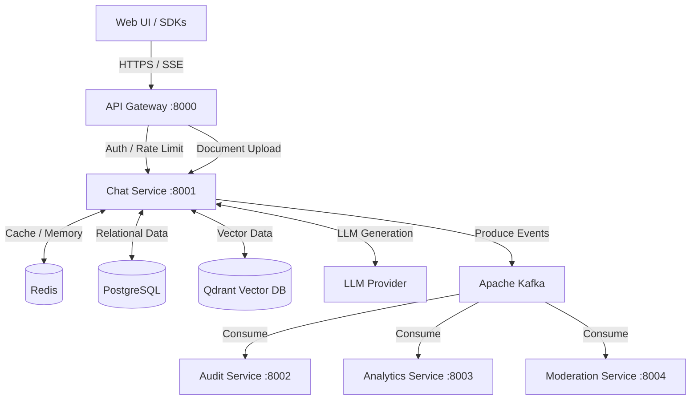

<div align="center">

# 🤖 Nexus Knowledge

### Enterprise Multi-Tenant Conversational AI Platform

[](#)
[](#)
[](#)
[](#)
[](#)
[](#-license)

**Secure, scalable, multi-tenant AI infrastructure built for the enterprise.**

Nexus Knowledge combines Retrieval-Augmented Generation (RAG), autonomous tool execution, and an event-driven microservices architecture to serve hundreds of isolated tenants at scale — without compromising on security or performance.

[Key Features](#-key-features) • [Architecture](#-architecture) • [Quick Start](#-quick-start) • [Security](#-security--access-control) • [Project Structure](#-project-structure) • [Deployment](#-production-deployment)

</div>

---

## 📋 Table of Contents

- [Key Features](#-key-features)
- [Architecture](#-architecture)
- [Quick Start](#-quick-start)
- [Web Interface](#-using-the-nexus-ai-web-ui)
- [Security & Access Control](#-security--access-control)
- [Project Structure](#-project-structure)
- [Production Deployment](#-production-deployment)
- [License](#-license)

---

## 🌟 Key Features

| Category | Capability |
|---|---|
| 🏢 **Multi-Tenancy** | Complete data isolation across PostgreSQL, Redis, and Qdrant, enforced via JWT / API Key RBAC |
| ⚡ **Event-Driven Architecture** | Fully decoupled, asynchronous message routing via Apache Kafka for audit logging, moderation, and analytics |
| 🔄 **Real-Time Streaming** | Server-Sent Events (SSE) stream AI-generated responses directly to the frontend |
| 🛠️ **Autonomous Agents & Tools** | LLMs securely invoke local tools (Calculator, Web Search, Weather, DB Query) via a `ToolPermissionManager` guardrail layer |
| 🔐 **Security & Guardrails** | Built-in prompt-injection defenses, PII scrubbing, rate limiting, and role-based access control |
| 💎 **Modern Web Interface** | Glassmorphic UI for managing chats, ingesting documents, and monitoring active agents |
| 🌐 **Language-Agnostic SDKs** | Auto-generated client libraries for Python, Node.js, Java, and C++ |

---

## 🏗️ Architecture

Nexus Knowledge follows a microservices pattern: a central Chat Service handles core LLM logic, while downstream services consume events off Kafka independently — keeping compliance, analytics, and moderation fully decoupled from the request path.



| Component | Port | Responsibility |
|---|---|---|
| API Gateway | `8000` | Ingress, authentication, RBAC, rate limiting |
| Chat Service | `8001` | Core LLM engine, RAG pipeline, tool execution |
| Audit Service | `8002` | Kafka consumer — compliance logging |
| Analytics Service | `8003` | Kafka consumer — usage metrics |
| Moderation Service | `8004` | Kafka consumer — PII / toxicity scanning |

---

## 🚀 Quick Start

### Requirements

- Docker & Docker Compose
- Python 3.11+ (for local development)

### 1 · Start Core Infrastructure

Boot the database, cache, vector store, and messaging layer:

```bash
docker-compose up -d postgres redis qdrant zookeeper kafka
```

### 2 · Run the Microservices

Run everything via Docker Compose:

```bash
docker-compose up -d --build
```

**— or —** run services individually for local development:

<table>
<tr><th>Terminal 1 — API Gateway</th></tr>
<tr><td>

```bash
cd api-gateway
pip install -r requirements.txt
python -m uvicorn src.main:app --app-dir src --host 0.0.0.0 --port 8000 --reload
```

</td></tr>
<tr><th>Terminal 2 — Chat Service</th></tr>
<tr><td>

```bash
cd services/chat-service
pip install -r requirements.txt
python -m uvicorn src.main:app --app-dir src --host 0.0.0.0 --port 8001 --reload
```

</td></tr>
</table>

---

## 💻 Using the Nexus Knowledge Web UI

The repository ships with a zero-dependency, enterprise-grade Glassmorphism frontend for interacting with the platform.

1. Open a new terminal.
2. Navigate to the frontend directory:
   ```bash
   cd frontend
   ```
3. Start a local web server:
   ```bash
   python -m http.server 3000
   ```
4. Open your browser to **[http://localhost:3000](http://localhost:3000)**

From there you can chat with the AI, monitor active autonomous tools, and upload documents for RAG indexing.

---

## 🔐 Security & Access Control

Nexus Knowledge enforces a zero-trust architecture — every request must pass through the **API Gateway** (`:8000`) for authentication and authorization before reaching internal services.

> ⚠️ **Development use only.** The credentials below are placeholders for local testing. Rotate and remove them before any staging or production deployment.

| Setting | Value |
|---|---|
| Test API Key | `cb_live_admin_key_123` |
| Test Tenant | `tenant_production` |

---

## 🛠️ Project Structure

```text
ChatBots_platform/
├── api-gateway/            # Ingress, Auth, RBAC, Rate Limiting
├── services/
│   ├── chat-service/       # Core LLM Engine, RAG, Tool Execution
│   ├── audit-service/      # Kafka Consumer: Compliance logging
│   ├── analytics-service/  # Kafka Consumer: Usage metrics
│   └── moderation-service/ # Kafka Consumer: PII/Toxicity scanning
├── frontend/                # Modern Glassmorphism Web UI
├── infra/                   # Kubernetes manifests & Nginx configs
├── sdks/                    # Language-agnostic client libraries
└── scripts/                 # CI/CD, backup, and health-check scripts
```

---

## 🚢 Production Deployment

Nexus Knowledge is designed for Kubernetes (K8s) deployments. Full instructions are available in `docs/deployment.md`.

Deploy via the automated script:

```bash
./scripts/deploy.sh production
```

---

## 📜 License

Proprietary Enterprise Software. All rights reserved.

<div align="center">

Built for teams that need AI at enterprise scale.

</div>